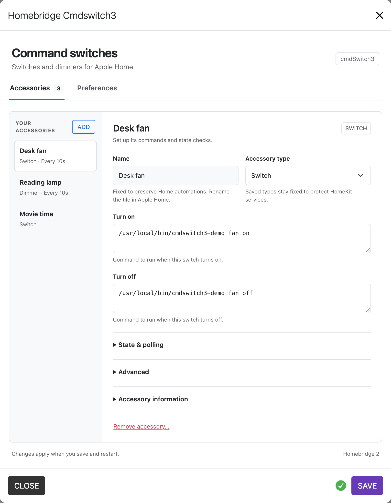
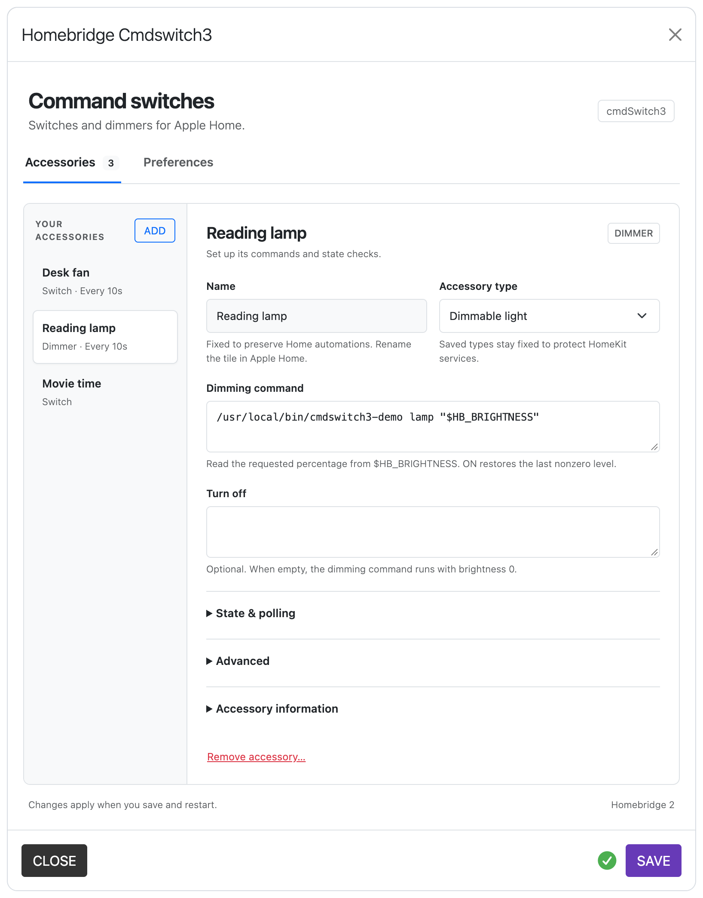
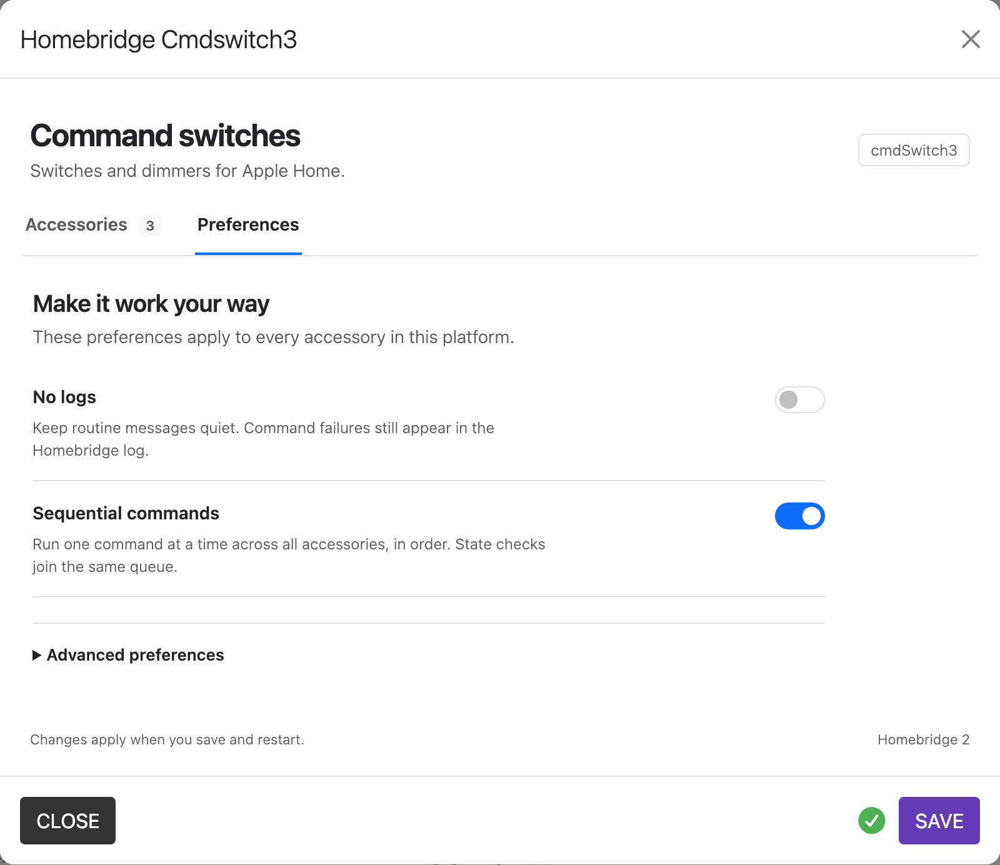

# homebridge-cmdswitch3


Run **local shell commands or remote commands over SSH** from switches and dimmable lights in Apple Home. Built for **Homebridge 2**, cmdSwitch3 is a maintained successor to [luisiam/homebridge-cmdswitch2](https://github.com/luisiam/homebridge-cmdswitch2), with a tidy settings page, optional quiet logging and bounded command execution. See the [SSH setup and examples](#remote-commands-over-ssh) for remote switches, status checks and momentary actions.

**Public beta: 1.0.0-beta.6.** Testers are welcome. Start with a fresh or isolated installation and follow [TESTING.md](TESTING.md). Existing cmdSwitch2 installations need a deliberate migration: read [MIGRATION.md](MIGRATION.md) before changing anything.

Beta.6 matches the settings page to Homebridge's native theme, with a darker accessory sidebar and an editor that matches the surrounding background. New installations default to the platform name `cmdSwitch3`; existing names are preserved and remain editable in Advanced preferences. Command execution is unchanged from beta.5. See [CHANGELOG.md](CHANGELOG.md). cmdSwitch3 has not been verified by the Homebridge team.

## Install the beta

In Homebridge UI's Plugins search, enter the full package name **`homebridge-cmdswitch3`**. This uses a direct package lookup if a broad search such as `cmdswitch` does not return it. Homebridge uses npm’s filtered search results, which can omit the package even when plain npm search finds it. Beta versions are not excluded by Homebridge’s search; verification is not required to appear.

From your Homebridge terminal, using the same npm installation/prefix as your existing plugins:

```sh
npm install -g homebridge-cmdswitch3@beta
```

The explicit `@beta` tag selects the testing release. This is not a stable release and does not automatically replace cmdSwitch2. Restart Homebridge after the first installation so it discovers the new plugin. Configure **cmdSwitch3** in Homebridge UI, preferably on its own child bridge for a fresh setup.

**npm tag note:** `latest` and `beta` are kept aligned so Homebridge's package lookup and verification checks select the current public beta. An unqualified install therefore selects a prerelease too. Use the explicit `@beta` tag to make your testing intent clear; no stable 1.0.0 has been released.

[Report a bug or share test results](https://github.com/jakemike1/homebridge-cmdswitch3/issues/new/choose) · [Release notes](CHANGELOG.md)

## What is included

- Original switches, momentary switches, dimming through `dim_cmd` and `$HB_BRIGHTNESS`, and `synchronous` sequential execution.
- Remote control through your system's SSH client, using commands or scripts and the Homebridge service account's SSH configuration. Each command can target a different host.
- A custom Homebridge settings page: accessory list, command editor, collapsible state/advanced settings, and a Preferences view. It follows Homebridge's theme and adapts to narrow screens.
- **No logs**, off by default, silences routine initialization, identification, state-change and successful-action messages. Errors remain visible. Command text, stdout and stderr are never logged.
- Real execution deadlines, bounded queues, shared state reads, completion-based polling, stale-result protection and shutdown cleanup.
- Successful commands may write to stderr. Exit status determines success. Failed writes reach HomeKit as errors and do not overwrite the last confirmed state.
- Modern promise-based HomeKit handlers. Homebridge 1 support, the old configuration wizard and the unbounded `ExecQueue` are removed.
- No runtime npm dependencies and no additional UI server process.

## Requirements

Homebridge 2.x, Node 22, 24 or 26, and Linux or macOS. Use a Node version supported by your Homebridge installation. Windows and Homebridge 1 are unsupported.

For remote commands, the Homebridge host also needs an SSH client and non-interactive access to the target machine. Configure SSH authentication outside the plugin; cmdSwitch3 uses your existing SSH setup and has no dedicated credential fields or connection manager.

The automated suite has 78 tests plus an offline packed-install check against Homebridge 2.4.0 / HAP-NodeJS 2.2.2. CI covers Linux x64, Linux ARM64 and macOS on Node 22, 24 and 26; see the exact release's CI results. A Raspberry Pi deployment of beta.5 retained six switches' HomeKit identities and pairing data, with all 42 readable characteristics passing. Beta.6 has not been deployed to that Pi. Physical dimming and controller-side automation execution still need broader testing. [Testing coverage and limitations](TESTING.md#what-has-been-tested) explain the evidence.

## Settings

Open the plugin's **Settings** page in Homebridge UI. Add an accessory, choose **Switch** or **Dimmable light**, and enter its commands. Use **Preferences** for No logs and Sequential commands. Edits update Homebridge's draft; the normal host **Save** button persists them. Restart the affected child bridge to apply changes.

The command fields accept local scripts or `ssh` commands. Expand **SSH examples & status** for setup guidance. For an SSH state command that follows the exit-code contract below, enable **Advanced → Strict state checks** so connection errors retain the previous state and are reported as failures. This is opt-in; existing settings and defaults stay unchanged.

New installations default to the platform name `cmdSwitch3`, shown in brackets in Homebridge logs. Existing custom names are preserved. Migrated installations may still show `[homebridge-cmdswitch2]` because their old platform name was retained. To change it, use **Preferences → Advanced preferences → Platform name**, then save and restart that child bridge. Accessory identities are unchanged: keep `switches[].name`, `_bridge` settings, pairing data and cached accessories unchanged. Homebridge also uses the platform name as the child bridge's display-name fallback when no separate bridge name is configured.

Existing accessory names and types are locked in the custom editor to preserve their identities. Rename their visible tiles in Apple Home. Removing an accessory requires a confirmation in the editor. The runtime refuses to silently replace a cached switch with a lightbulb or vice versa.

Unknown configuration fields and existing child-bridge settings survive edits. The JSON schema is also included for validation and standard tooling. Editing settings never executes a device command.

The custom editor currently edits the first cmdSwitch3 platform block returned by Homebridge UI. Additional blocks are preserved. Use Homebridge's JSON configuration editor for those additional blocks, keeping their accessory names, types and child-bridge identifiers intact.

### Startup and error recovery

Installing the package alone starts no commands. A platform without a `switches` list stays inactive and retains its cached accessories. An explicit empty list (`"switches": []`) intentionally removes that platform's cached accessories when it starts.

Invalid settings, inconsistent cached identities/services or an unexpected accessory startup/state-publication failure disable the affected platform and log a diagnostic, even when No logs is enabled. Commands and polling stop; cached accessories are retained. HomeKit requests on bound accessories report an error while the platform is disabled. Correct the cause and restart its child bridge; do not delete pairing or cache files as a workaround. Unexpected error details and command contents are omitted from logs.

Ordinary command failures affect the operation/accessory and can recover on a later successful read or write. They do not automatically disable the whole platform. A command-output stream failure is reported as `OUTPUT_FAILED` and stops that command.

### Screenshots

Light-mode settings captured in Homebridge UI with a dedicated demo configuration. The sample commands shown only change local demo state; they are not bundled device integrations.



<details>
<summary>Dimmer settings</summary>



</details>

<details>
<summary>Quiet logging and sequential commands</summary>



</details>

### Example

These are placeholder script paths, not supplied device integrations:

```json
{
  "platform": "cmdSwitch3",
  "name": "cmdSwitch3",
  "noLogs": false,
  "synchronous": false,
  "switches": [
    {
      "name": "Desk power",
      "on_cmd": "/usr/local/bin/desk-power on",
      "off_cmd": "/usr/local/bin/desk-power off",
      "state_cmd": "/usr/local/bin/desk-power status",
      "polling": true,
      "interval": 10
    },
    {
      "name": "Reading lamp",
      "dim_cmd": "/usr/local/bin/lamp dim \"$HB_BRIGHTNESS\"",
      "state_cmd": "/usr/local/bin/lamp brightness",
      "brightness": 60
    }
  ]
}
```

### Commands and brightness

Commands run in the system shell as the Homebridge service user, inheriting its environment. Keep scripts and credentials outside this package. Grant only the permissions your commands need.

For a switch, `state_cmd` exit 0 means ON and any nonzero exit means OFF. Enable `strictState` to accept only exit 0 (ON) and 1 (OFF), reporting other codes as errors. A state-read timeout, signal or output overflow is always an error and retains the previous state.

For a dimmer, a successful `state_cmd` must print only an integer **0–100**, with optional surrounding whitespace. Zero means OFF. Invalid output is an error. A nonzero exit follows the same OFF/strict-state rules. Both On and Brightness share this one state check.

A brightness write runs `dim_cmd` with `HB_BRIGHTNESS` set to the requested percentage. ON restores the last successful nonzero level using `dim_cmd`; it does not run `on_cmd`. OFF runs `off_cmd` if configured, otherwise `dim_cmd` with level 0. OFF preserves the remembered level for the next ON. Fresh dimmers default to 100%; a configured initial level is used only when no valid cached brightness exists. An initial zero has a 100% ON fallback.

For a switch with one action and no state command, the opposite direction is a passive reset. After a successful action it resets after one second without executing an undefined command. Dimmers do not momentarily reset. A missing action on a state-backed switch is reported as an error.

### Remote commands over SSH

All hosts, accounts and script paths below are examples to adapt. The scripts are not bundled, and pasting an example does not install them. An SSH command runs on the remote machine with the remote account's permissions; the SSH client runs locally as the Homebridge service user.

#### Set up the Homebridge account

Configure a host alias in the **Homebridge service account's** `~/.ssh/config`, using that account's actual home directory. A successful login from your personal terminal does not establish that Homebridge can connect. For example:

```sshconfig
Host homebridge-device
    HostName 192.0.2.20
    User device-control
    Port 22
    IdentityFile ~/.ssh/cmdswitch3_ed25519
    IdentitiesOnly yes
    BatchMode yes
    StrictHostKeyChecking yes
    ConnectTimeout 3
```

Replace the example address, account and key path. Install the public key on the target, keep the private key accessible only to the service account, and add the host key to that account's `known_hosts` after verifying its fingerprint through a trusted route. An encrypted key needs an agent available to the running Homebridge service; it cannot wait for a passphrase prompt.

`BatchMode yes` prevents interactive authentication prompts, and `StrictHostKeyChecking yes` requires a trusted host key. `ConnectTimeout` bounds connection establishment; cmdSwitch3's action/state deadline still covers the entire local command, including queue time. See the [OpenSSH configuration reference](https://man.openbsd.org/ssh_config.5).

#### Remote on/off switch

Add this accessory to your existing `switches` list. The action scripts must exit 0 only when successful. The state helper must follow the status contract in the next section.

```json
{
  "name": "Remote desk power",
  "on_cmd": "ssh -n homebridge-device /usr/local/bin/device-power on",
  "off_cmd": "ssh -n homebridge-device /usr/local/bin/device-power off",
  "state_cmd": "ssh -n homebridge-device /usr/local/bin/device-power-state",
  "strictState": true,
  "polling": true,
  "interval": 10,
  "commandTimeout": 8,
  "stateTimeout": 5
}
```

`-n` keeps SSH from waiting for input on stdin. Use another SSH alias in a command to control another machine. Set up and check each alias under the same service account.

#### Keep OFF distinct from a failed status check

With `strictState: true`, use this contract for a switch's **state command**:

| Exit status | Meaning                                       | cmdSwitch3 result                          |
| ----------- | --------------------------------------------- | ------------------------------------------ |
| `0`         | Confirmed ON                                  | Publish ON                                 |
| `1`         | Confirmed OFF                                 | Publish OFF                                |
| `2`–`254`   | Status unavailable or remote command failed   | Report an error; retain the previous state |
| `255`       | SSH error, or the remote command returned 255 | Report an error; retain the previous state |

[OpenSSH returns the remote command's exit status, or 255 for an SSH error](https://man.openbsd.org/ssh.1#EXIT_STATUS). Without strict checks, a nonzero exit is treated as OFF for compatibility. Strict checks cannot distinguish an actual error returned as `1` from a confirmed OFF result, so adapt your remote status command accordingly. A retained value is the last known state, not a fresh confirmation that the device is reachable.

For a device utility that successfully prints `on` or `off` and returns nonzero on failure, this example remote `/usr/local/bin/device-power-state` helper maps output and errors explicitly:

```sh
#!/bin/sh
device_status=$(/usr/local/bin/device-power status-text) || exit 2
case "$device_status" in
    on)  exit 0 ;;
    off) exit 1 ;;
    *)   exit 2 ;;
esac
```

Adapt the utility and expected output to your device, and make the helper executable on the remote host. For example, a failed utility call that exits 1 becomes error 2, rather than a false OFF. Switch state checks use exit codes, not the words printed to stdout. ON/OFF **actions** always require exit 0; `strictState` affects only state checks.

Preserve failures all the way back to Homebridge. Avoid `ssh ...; true`, `ssh ... || exit 1`, or pipelines that discard SSH's exit status. Use `first-command && second-command` when the second action depends on the first succeeding. A timeout or disconnect may leave a remote action's outcome unknown; check its actual state before retrying.

#### Momentary action and dimmer examples

A one-shot action needs only an ON command. Leave OFF and state commands empty to use the existing one-second passive reset after success:

```json
{
  "name": "Remote refresh",
  "on_cmd": "ssh -n homebridge-device /usr/local/bin/device-refresh"
}
```

The remote action should return promptly with its real result. The reset only changes the HomeKit switch; it does not send a second SSH command.

For a dimmer, a command such as `ssh -n homebridge-device "/usr/local/bin/lamp dim $HB_BRIGHTNESS"` passes the requested number to the remote script. The local shell expands `$HB_BRIGHTNESS`. Its state command must exit 0 and print only an integer 0–100; use 0 for OFF. Enable strict checks and return an error code greater than 1 when brightness cannot be read.

#### Check the setup

Before enabling polling, run a harmless command and the status helper as the actual Homebridge service account. On a host where that account is named `homebridge`, these examples check access and display the status exit code:

```sh
sudo -u homebridge -H ssh -n homebridge-device /usr/bin/true
sudo -u homebridge -H ssh -n homebridge-device /usr/local/bin/device-power-state
state_exit=$?
printf 'State exit: %s\n' "$state_exit"
```

Use the account and home directory your service actually uses. If access works in your terminal but fails in Homebridge, check its SSH alias, readable key, trusted host key and agent availability. Run the status command manually as that account to inspect errors; cmdSwitch3 intentionally omits command text, stdout and stderr from its logs, even when routine logging is enabled. Neither editing settings nor opening the SSH help runs these examples.

### Timing and ordering

| Setting                 | Default | Meaning                                                                                                                |
| ----------------------- | ------- | ---------------------------------------------------------------------------------------------------------------------- |
| `synchronous`           | `false` | One command at a time across this platform, in acceptance order, including checks and dimmers.                         |
| `maxConcurrentCommands` | `4`     | Parallel command limit, 1–16. Ignored in sequential mode.                                                              |
| `polling`               | `false` | Background state checks; startup still reads a configured state command.                                               |
| `interval`              | `1`     | Seconds after the previous poll finishes, 1–86400.                                                                     |
| `timeout`               | `1`     | Post-action state refresh delay in seconds, 0–60. Retained configuration key; never acknowledges an unfinished action. |
| `commandTimeout`        | `8`     | Action deadline including queue wait, 1–8 seconds.                                                                     |
| `stateTimeout`          | `5`     | State-check deadline including queue wait, 1–8 seconds.                                                                |
| `queueLimit`            | `8`     | Maximum outstanding actions per accessory, 1–64.                                                                       |
| `strictState`           | `false` | Report state-command exits other than 0/1 as failures.                                                                 |

Commands for one accessory are always serialized. State reads never overlap that accessory's actions. Sequential mode also preserves the order of successive writes across different accessories. A failed action cancels later queued actions for that accessory, without retrying them; other accessories can continue. Global pending commands are limited to 128. Queues are not persisted across restart.

On POSIX systems, deadlines cancel the process group with TERM followed by KILL after a 250 ms grace period. Output is limited to 1 MiB per stream. Only dimmer state checks retain stdout long enough to parse the number. Long-running work should be handled by a supervised service whose start/stop command returns promptly and truthfully.

The plugin can only act on a shell's final exit status. Use `first-command && second-command` when the second step should happen only after success. `first-command; second-command` can hide a failure. This package does not install device-specific helpers. A deliberately harmless OFF command such as `/bin/true` remains harmless.

## Development and local build

```sh
npm ci --ignore-scripts
npm run build
npm run format:check
npm run test:package
npm pack --ignore-scripts
```

`build` runs syntax/shared-validator checks and the test suite. `build:ui` regenerates the browser validator from the runtime validator after changes to `config.js`. `publishConfig.tag` defaults publication to `beta`; stable releases require an explicit release decision. The tarball contains only runtime files, UI assets and documentation, excluding tests, preview fixtures and development dependencies.

`test:package` packs and installs the actual archive offline in a disposable directory. It compares installed bytes with source and exercises real Homebridge registration, inactive startup, harmless commands and shutdown without a TTY or publishing a HomeKit server. It never installs globally or accesses an existing Homebridge instance.

For a browser preview, extract the official `homebridge-config-ui-x@5.28.0` npm package into a temporary directory and set `HOMEBRIDGE_UI_PATH` to its `package` directory, then run `npm run preview`. It binds only to `127.0.0.1:43183`, uses example accessories, and does not start Homebridge or execute configured commands. Its Save button affects only the preview's in-memory draft. The same packaged settings HTML/CSS/JS runs inside the real Homebridge UI bridge.

## Origin and licence

The Git history starts at the original repository; this work branches from commit `c3b293e569053ea427f84ab01bc66e190ef905c7`. The original Apache-2.0 `LICENSE` is retained byte-for-byte. Attribution and changes are recorded in [NOTICE](NOTICE).

The original and downstream manifests historically said ISC despite shipping the Apache-2.0 licence. This successor uses Apache-2.0 to match the continuously shipped licence file; the historical metadata discrepancy does not establish the original author's intent. No endorsement by the original author is implied.
